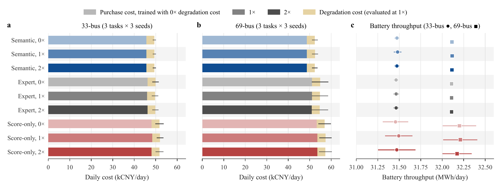

# Fig. S1: battery-degradation retraining

**Fig. S1.** Purchase and battery-degradation costs on the 33-bus (a) and 69-bus (b) systems and battery-side throughput on both systems (c) after retraining with zero, one, and two times the nominal degradation coefficient ($c_{\mathrm{deg}} = 116.6$ CNY/MWh); means over three preference settings and three seeds. Degradation costs are evaluated at the nominal coefficient. The corresponding operating metrics are given in Table V of the manuscript; all rows, including the zero coefficient, come from the retraining runs of the degradation study.
